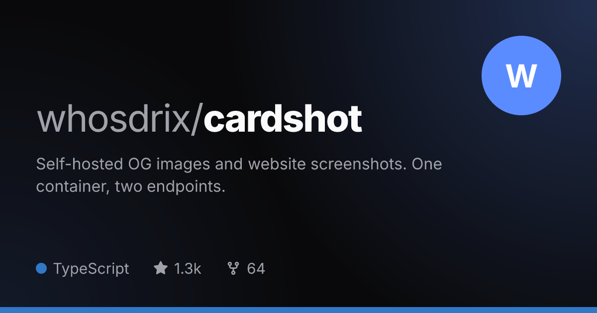
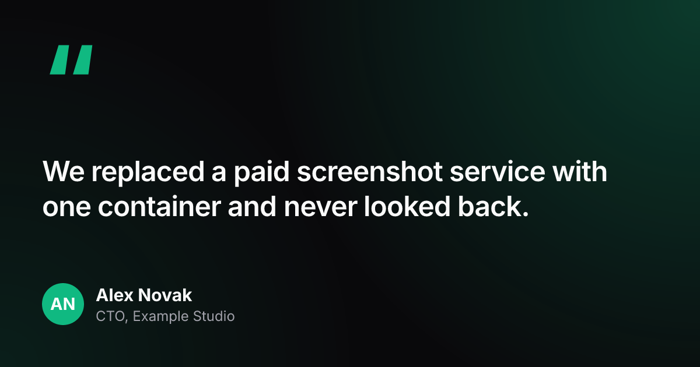
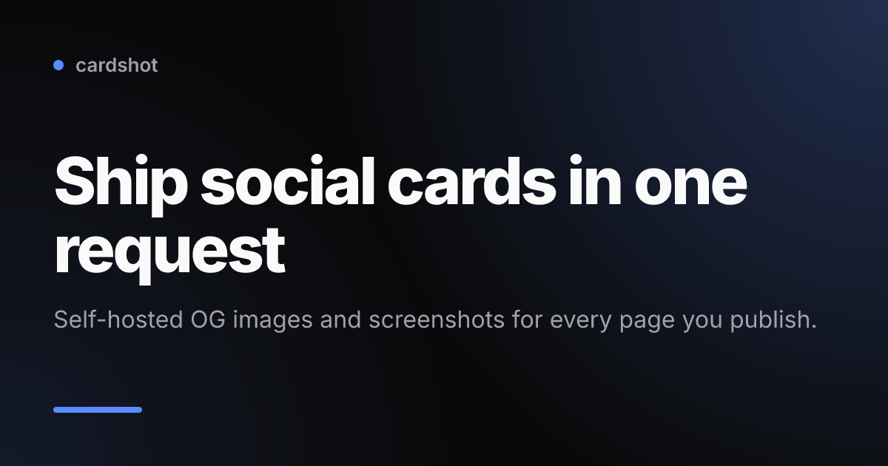

<h1 align="center">cardshot</h1>

<p align="center">
  <strong>Self-hosted OG images and website screenshots.</strong><br>
  One container, two endpoints, beautiful templates.
</p>

<p align="center">
  <a href="https://github.com/whosdrix/cardshot/actions/workflows/ci.yml"></a>
  <a href="https://github.com/whosdrix/cardshot/releases"></a>
  <a href="LICENSE"></a>
</p>

<p align="center">
  
  
  
  
</p>

## Quick start

```sh
docker run -p 3000:3000 ghcr.io/whosdrix/cardshot
```

Then open these in your browser:

```
http://localhost:3000/og?title=Hello%20world&subtitle=My%20first%20card
http://localhost:3000/shot?url=https://github.com&width=1280&height=800
```

`http://localhost:3000` shows a gallery of every template.

## Why cardshot

Every page you publish needs a social card, and plenty of apps need screenshots. Hosted services charge per image, and framework-specific tools only work inside one framework or host.

cardshot is one small service you run yourself:

- **`/og`** renders social cards from templates in about 60 ms, using [Satori](https://github.com/vercel/satori) and [resvg](https://github.com/thx/resvg-js). No browser involved.
- **`/shot`** takes real browser screenshots with Chromium: viewport, full page or a single element, light or dark.
- **Signed URLs** so nobody else can use your instance.
- **Disk cache** with ETags, so each image is rendered once.
- **SSRF protection** on every request the browser makes, not just the first one.
- Works with any stack: it is just a URL you put in a `<meta>` tag.

## Social cards: `GET /og`

```html
<meta property="og:image" content="https://cards.example.com/og?template=blog&title=How%20we%20ship&author=Jane%20Doe&date=Nov%2027" />
```

| Param      | Default       | Description                                 |
| ---------- | ------------- | ------------------------------------------- |
| `template` | `basic`       | `basic`, `blog`, `repo`, `product`, `quote` |
| `theme`    | `dark`        | `dark` or `light`                           |
| `accent`   | `5b8cff`      | Any hex color, with or without `#`          |
| `w`, `h`   | `1200`, `630` | Size in pixels (200 to 2400)                |
| `scale`    | `1`           | Pixel density for crisp images (1 to 3)     |
| `format`   | `png`         | `png` or `svg`                              |

Each template has its own parameters. `GET /templates` lists them with a working example URL.

<details>
<summary><strong>Templates and their parameters</strong></summary>

| Template  | Parameters                                                                                   |
| --------- | -------------------------------------------------------------------------------------------- |
| `basic`   | `title`, `subtitle`, `site`, `logo`                                                          |
| `blog`    | `title`, `author`, `avatar`, `date`, `readingTime`, `tags` (comma separated), `site`, `logo` |
| `repo`    | `owner`, `name`, `description`, `language`, `languageColor`, `stars`, `forks`, `avatar`      |
| `product` | `title`, `tagline`, `price`, `cta`, `image`, `site`, `logo`                                  |
| `quote`   | `quote`, `author`, `role`, `avatar`, `site`, `logo`                                          |

`logo`, `avatar` and `image` accept a public image URL or a `data:` URI. Images that cannot be fetched safely are skipped, so a broken logo never breaks the card.

</details>

<p align="center">
  
  
</p>

## Screenshots: `GET /shot`

```
/shot?url=https://example.com&width=1440&height=900&scale=2&dark=true
```

| Param             | Default       | Description                                   |
| ----------------- | ------------- | --------------------------------------------- |
| `url`             | required      | Page to capture (`http` or `https`)           |
| `width`, `height` | `1280`, `800` | Viewport size                                 |
| `scale`           | `1`           | Device pixel ratio (1 to 3)                   |
| `fullPage`        | `false`       | Capture the whole scrollable page             |
| `selector`        |               | Capture one element, e.g. `#pricing`          |
| `waitFor`         |               | Wait until this selector is visible           |
| `delay`           | `0`           | Extra wait in ms before capturing (max 10000) |
| `dark`            | `false`       | Emulate `prefers-color-scheme: dark`          |
| `hide`            |               | Comma-separated selectors to hide             |
| `clean`           | `true`        | Hide common cookie banners                    |
| `format`          | `png`         | `png` or `jpeg`                               |
| `quality`         | `85`          | JPEG quality                                  |

## Signed URLs

Set `SIGNING_SECRET` and every `/og` and `/shot` request must carry a valid `sig` parameter: an HMAC-SHA256 of the path and the sorted query string.

```sh
docker run --rm -e SIGNING_SECRET=change-me ghcr.io/whosdrix/cardshot node dist/cli.js sign "/og?title=Hello"
# /og?title=Hello&sig=3f1c...
```

Or in your own code:

```ts
import { createHmac } from 'node:crypto'

function signUrl(path: string, params: Record<string, string>, secret: string) {
  const query = new URLSearchParams(Object.entries(params).sort(([a], [b]) => a.localeCompare(b)))
  const sig = createHmac('sha256', secret).update(`${path}?${query}`).digest('hex')
  return `${path}?${query}&sig=${sig}`
}
```

## Configuration

| Env var              | Default           | Description                                                           |
| -------------------- | ----------------- | --------------------------------------------------------------------- |
| `PORT`               | `3000`            | HTTP port                                                             |
| `SIGNING_SECRET`     |                   | Require signed URLs. Strongly recommended in production               |
| `CACHE_DIR`          | `/data` in Docker | Where rendered images are cached                                      |
| `CACHE_TTL`          | `604800`          | Seconds before a cached image is re-rendered                          |
| `CACHE_MAX_AGE`      | `86400`           | `Cache-Control` max-age sent to browsers and CDNs                     |
| `SHOT_CONCURRENCY`   | `2`               | Screenshots taken in parallel                                         |
| `SHOT_TIMEOUT`       | `15000`           | Screenshot timeout in ms                                              |
| `ALLOW_PRIVATE_URLS` | `false`           | Allow screenshots of localhost and private networks. Development only |
| `CHROMIUM_PATH`      |                   | Use a specific Chrome or Chromium binary                              |

## Deploy

**docker compose**

```sh
curl -O https://raw.githubusercontent.com/whosdrix/cardshot/main/docker-compose.yml
SIGNING_SECRET=$(openssl rand -hex 32) docker compose up -d
```

**Anywhere that runs containers:** Fly.io, Railway, Render, Coolify, Kubernetes. Use the image `ghcr.io/whosdrix/cardshot`, expose port `3000`, set `SIGNING_SECRET` and mount a volume at `/data` to keep the cache.

Put a CDN in front of it and most requests never reach your server.

## How it compares

|                          | cardshot | Vercel OG        | Hosted screenshot APIs |
| ------------------------ | -------- | ---------------- | ---------------------- |
| Social cards             | ✓        | ✓                | some                   |
| Website screenshots      | ✓        |                  | ✓                      |
| Runs anywhere            | ✓        | Vercel / Next.js |                        |
| Price                    | free     | free on Vercel   | per image              |
| Your data stays with you | ✓        | ✓                |                        |

## Development

```sh
npm install
npm run dev
```

See [CONTRIBUTING.md](CONTRIBUTING.md) for adding templates, and [SECURITY.md](SECURITY.md) for the security model.

## License

[MIT](LICENSE)
